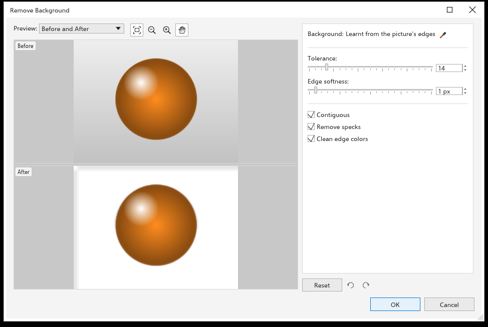

# Removing the background of a bitmap

[[menu.bitmaps > menu.bitmaps.remove_background_local]] makes the background
of a photo or scan transparent and keeps the subject. It works on this
computer and needs no AI service. The property bar of a selected bitmap has
the same command.

## To remove a background {#remove}

1. Select one or more bitmaps.
2. Click [[menu.bitmaps > menu.bitmaps.remove_background_local]]. The
   preview shows the bitmap before and after, with a checkerboard where it
   becomes transparent.
3. Set the options below until the subject stands out cleanly.
4. Click [[dialog.ok]]. Every selected bitmap changes in one undo step.

## Options {#options}

- **[[dialog.bg_colors]]** The colors to remove, one row each. At first
  there is one row, **[[dialog.bg_colors_auto_button]]**: TraceDraw learns
  the background's colors from the edges of the picture (up to four, so a
  gradient or a two-tone backdrop works). Each row has:
  - its swatch;
  - an eyedropper: click it, then click a color in a preview or on the
    drawing, and the row takes that color. On the first row,
    **[[dialog.bg_colors_auto_button]]** goes back to the learnt colors;
  - its own tolerance, a whole number from 0 to 100. It shows the
    **[[dialog.tolerance]]** below until you change it;
  - **[[dialog.bg_row_remove]]** (x), which takes the row out. The last row
    always stays.

  **[[dialog.bg_add_color]]** (+) adds a row: click it, then click the
  color in the Before preview or on the drawing. A pixel counts as
  background when it is close enough to any color of the list, each color
  with its own tolerance.
- **Shortcuts with the eyedropper on** Shift+click in a preview adds the
  color under the pointer as a new row and keeps the eyedropper on, so you
  can pick several colors in a row. Alt+click takes out the row whose color
  is nearest to the one under the pointer. A color picked in a preview is
  taken from the picture before the change, so a part already removed can
  still be picked.
- **[[dialog.tolerance]]** How far a color may be from the background's and
  still count as background (0 to 100, whole numbers). It is the tolerance
  of every row that has none of its own. Raise it when some backdrop stays;
  lower it when parts of the subject go.
- **[[dialog.edge_softness]]** Feathers the edge of the subject, in pixels.
  0 keeps a hard edge.
- **[[dialog.bg_contiguous]]** (on at first) Only the background connected to
  the edges of the picture goes, so a white shirt on a white backdrop keeps
  its inside. A color picked in a preview also starts the removal from the
  point where you clicked, so a hole inside the subject can go with one
  pick. Turn it off to remove every pixel near a listed color, for example
  all the holes of a letter or a ring.
- **[[dialog.bg_despeckle]]** (on at first) Small loose spots left in the
  background go too.
- **[[dialog.bg_clean_edges]]** (on at first) Takes the old background's color
  out of the half-transparent pixels of the edge, so no light or dark halo
  shows when the subject goes on another background.
- **[[dialog.reset]]**, under the settings, puts every option back, with one
  [[dialog.bg_colors_auto_button]] row; the two arrows beside it undo and
  redo the changes made in the dialog box.

[[dialog.ok]] remembers the options and the list of colors until you close
TraceDraw, so the next Remove Background starts with them.

## Tips {#tips}

- It works best on a backdrop that differs from the subject: a studio
  background, a sky, a product on a plain table. For busy scenes, the AI
  command [[menu.bitmaps.remove_background]] (see
  [AI](../customize/ai.md)) separates subject and scene by their meaning.
- The result replaces the pixels; effects on the bitmap are made permanent.
  To fine-tune afterwards, use [Masking colors](bitmap-mask.md).
