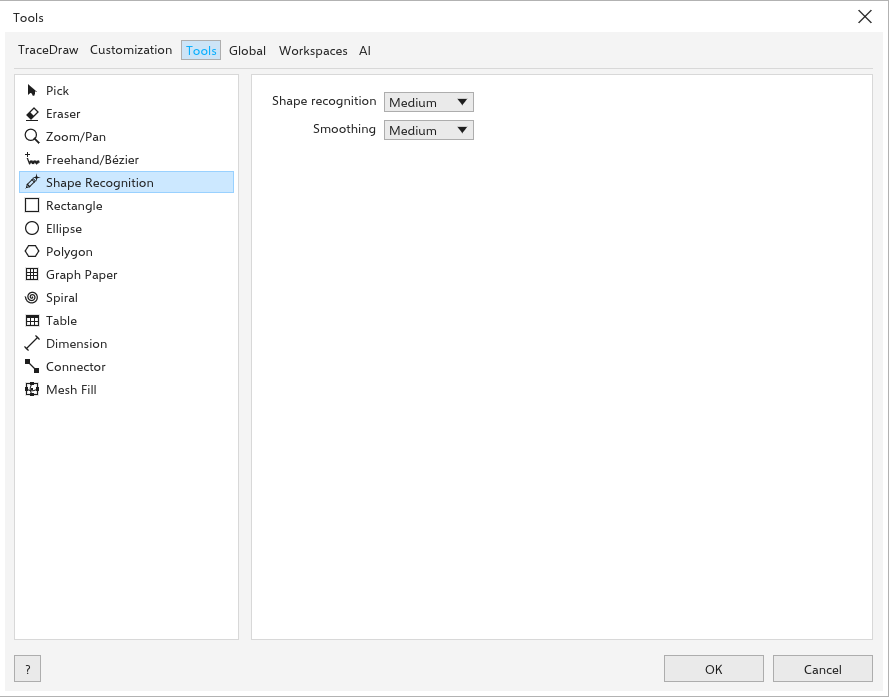
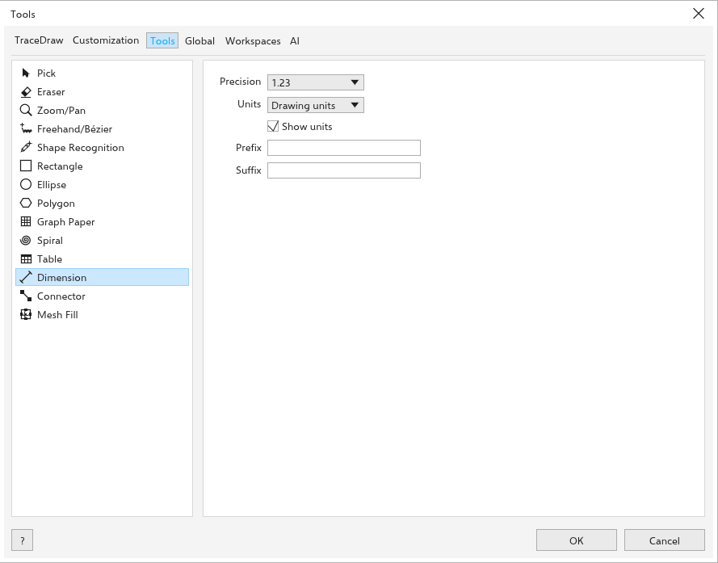
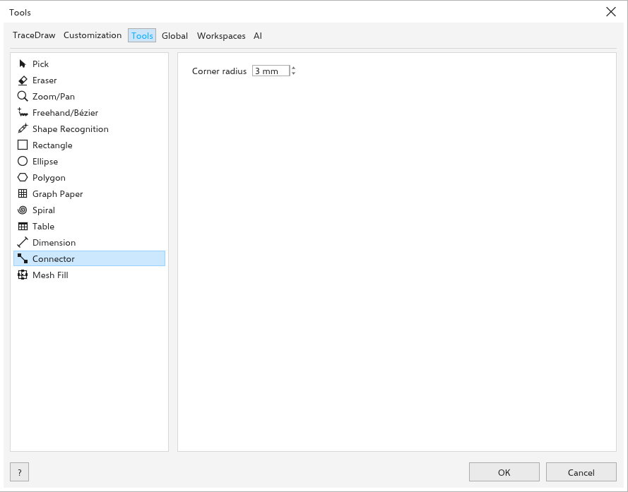
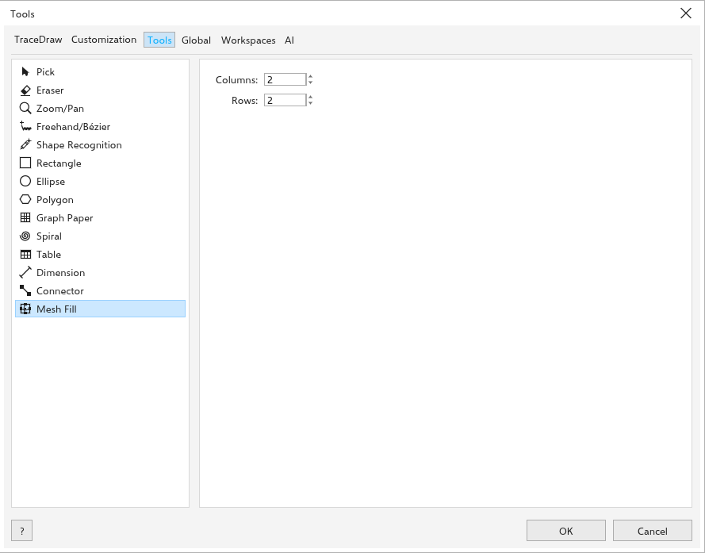

# Opciones de herramientas

> *Traducción automática: esta página puede ir por detrás de la versión en inglés.*

[[menu.tools > menu.tools.options > menu.tools.options_tools]] ajusta cómo se
comportan las herramientas y qué objetos nuevos dibujan. La mayoría de estos
valores también están en la barra de propiedades de cada herramienta.

## Selección {#pick}

- [[options.crosshair_cursor]]: el puntero es una cruz.
- [[options.treat_all_filled]] (activado): hacer clic dentro de un objeto sin
  relleno lo selecciona.
- [[options.marquee_touching]] (desactivado): un marco de selección también
  selecciona los objetos que solo toca; <kbd>Alt</kbd> selecciona entonces
  solo los que están por completo dentro.

## Borrador {#eraser}

[[options.eraser_width]] (6,35 mm de forma predeterminada), y
[[options.eraser_round]] o [[options.eraser_square]].

## Zoom y desplazamiento {#zoom-pan}

- [[options.zoom_right_button]]: [[options.zoom_out]] (opción predeterminada)
  o el [[options.context_menu]].
- [[options.wheel_action]]: [[options.wheel_zoom]] o [[options.wheel_scroll]].

## Mano alzada/Bézier {#curves}

- [[options.freehand_smoothing]]: de 0 a 100 (50 de forma predeterminada).
- [[options.join_within]]: a qué distancia de un nodo final debe empezar una
  línea para continuar la curva (5 píxeles de pantalla de forma
  predeterminada). Vea [Continuar una curva](../lines-shapes/lines.md#continue).

- [[options.pen_preview]] y [[options.pen_auto_add_delete]] (ambas activadas)
  para la herramienta [[tool.pen]]; vea [Pluma](../lines-shapes/lines.md#pen).
- [[options.pen_tablet]]: [[options.pen_pressure]] (activada); vea
  [Dibujar con una tableta gráfica](../lines-shapes/pen-pressure.md).

## Reconocimiento de formas {#shape-recognition}

[[recognize.recognition]] y [[recognize.smoothing]] de la herramienta Reconocimiento
de formas, de desactivado a máximo, como en su barra de propiedades.

## Rectángulo {#rectangle}

[[options.rectangle_corners]]: [[toolbar.corner_round]],
[[toolbar.corner_scallop]] o [[toolbar.corner_chamfer]], los cuatro tamaños de
esquina y [[toolbar.corners_together]]. [[options.scale_corners]]:
[[toolbar.relative_corners]].

## Elipse {#ellipse}

[[options.ellipse]], [[options.pie]] o [[options.arc]], con el
[[options.starting_angle]] y el [[options.ending_angle]].

## Polígono {#polygon}

[[options.number_of_points]] y [[options.sharpness]].

## Papel cuadriculado {#graph-paper}

[[options.rows]] y [[options.columns]] de la cuadrícula.

## Espiral {#spiral}

[[options.revolutions]], y [[options.symmetrical_spiral]] o
[[options.logarithmic_spiral]].

## Tabla {#table}

[[options.rows]] y [[options.columns]] de las tablas nuevas.

## Cota {#dimension}

Cómo se lee la etiqueta de las cotas nuevas: [[dimension.precision]],
[[dimension.units]], [[dimension.show_units]], [[dimension.prefix]] y
[[dimension.suffix]]. Las cotas ya dibujadas mantienen su etiqueta; seleccione
una y use la barra de propiedades para cambiarla.

## Conector {#connector}

[[connector.radius]] de los conectores redondeados nuevos (3 mm al principio).

## Relleno de malla {#mesh-fill}

[[options.columns]] y [[options.rows]] de la cuadrícula con la que empieza un
relleno de malla nuevo (2 por 2 al principio).
