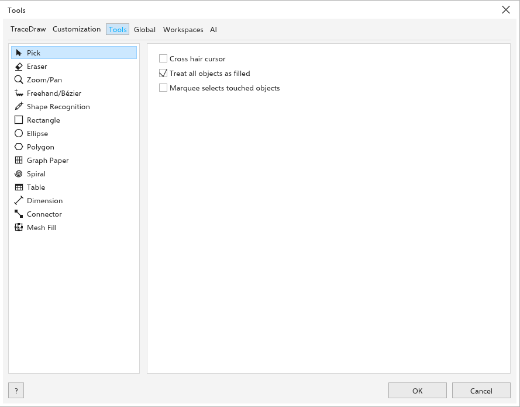
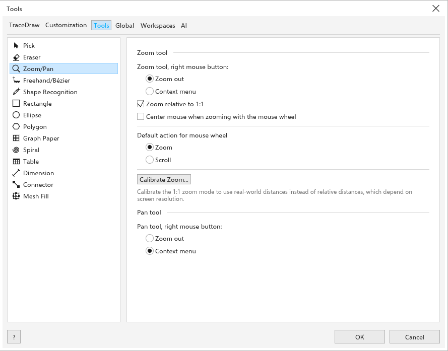
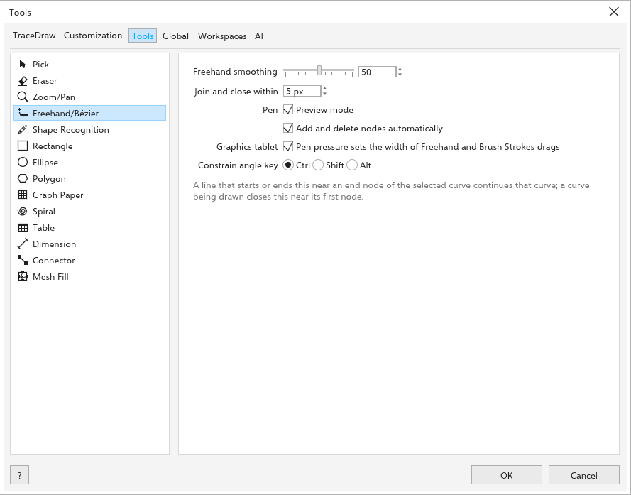
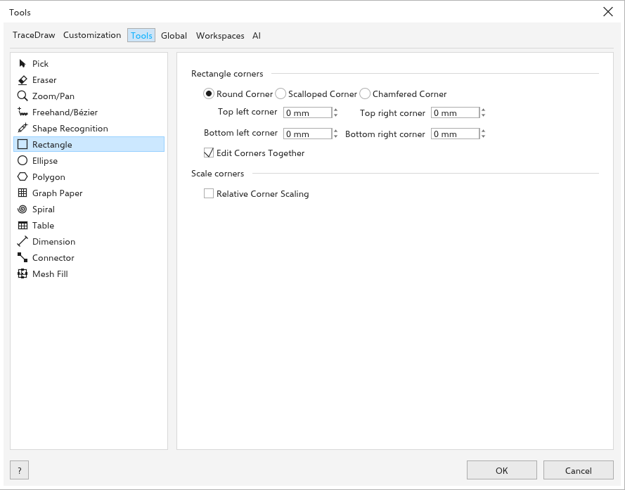
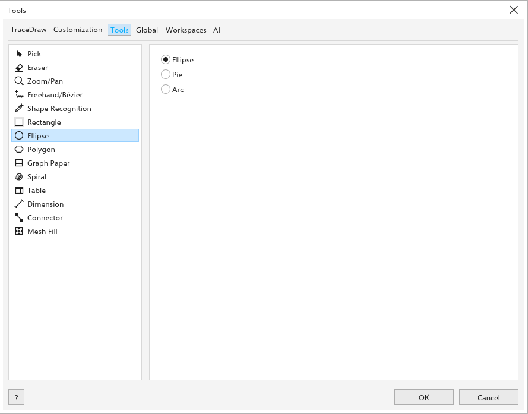
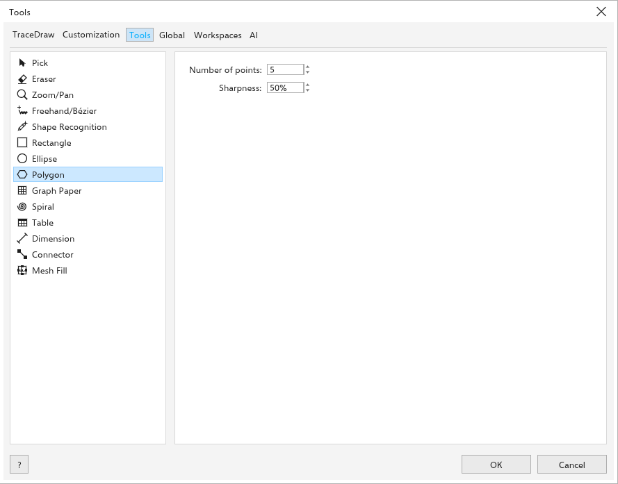
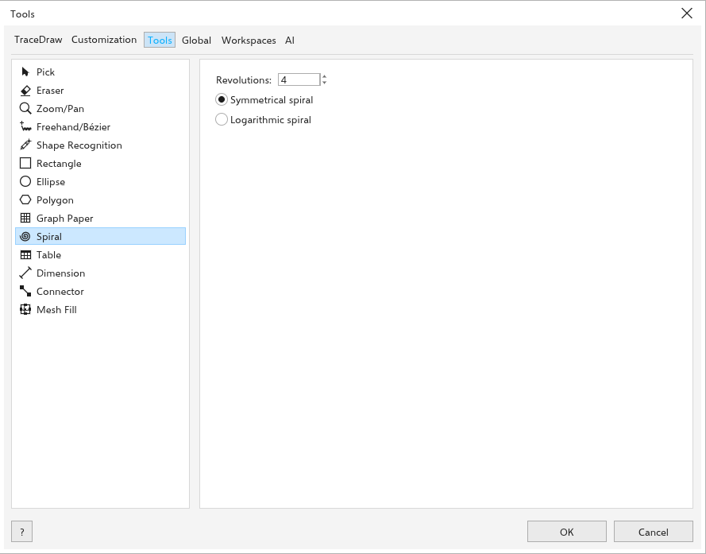
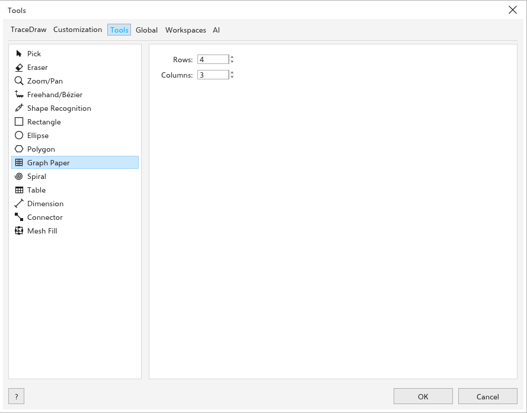
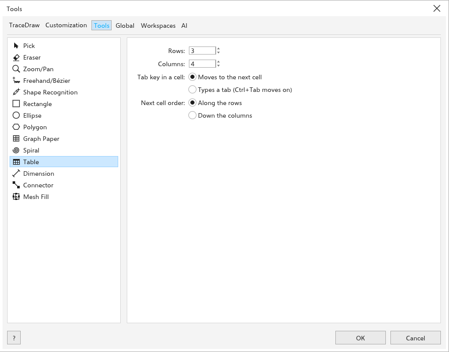
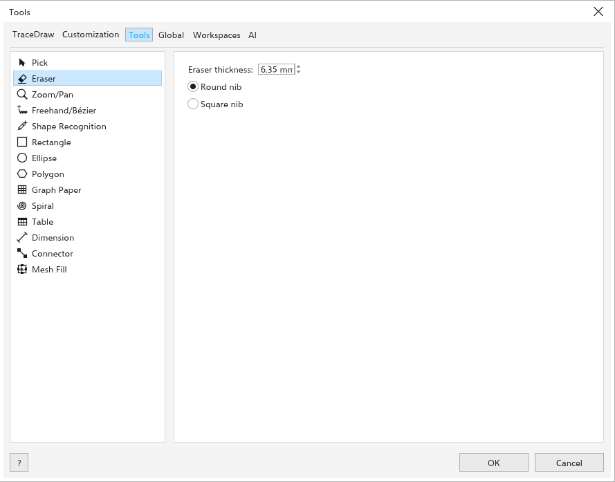

# Opcje narzędzi

> *Tłumaczenie maszynowe: ta strona może być mniej aktualna niż wersja angielska.*

[[menu.tools > menu.tools.options > menu.tools.options_tools]] określa działanie
narzędzi i to, jakie nowe obiekty rysują. Większość tych wartości znajduje się
również na pasku właściwości każdego narzędzia.

## Wskaźnik {#pick}

- [[options.crosshair_cursor]]: wskaźnik ma postać krzyża.
- [[options.treat_all_filled]] (włączone): kliknięcie wewnątrz niewypełnionego
  obiektu zaznacza go.
- [[options.marquee_touching]] (wyłączone): ramka zaznaczenia zaznacza też
  obiekty, których tylko dotyka; <kbd>Alt</kbd> zaznacza wtedy tylko obiekty
  całkowicie wewnątrz.

## Powiększenie i przesuwanie {#zoom-pan}

- [[options.zoom_right_button]]: [[options.zoom_out]] (domyślnie) lub
  [[options.context_menu]].
- [[options.wheel_action]]: [[options.wheel_zoom]] lub [[options.wheel_scroll]].

## Krzywe {#curves}

- [[options.freehand_smoothing]]: od 0 do 100 (domyślnie 50).
- [[options.join_within]]: jak blisko węzła końcowego musi zaczynać się linia,
  aby kontynuować krzywą (domyślnie 5 pikseli ekranu). Zobacz
  [Kontynuowanie krzywej](../lines-shapes/lines.md#continue).

- [[options.pen_preview]] i [[options.pen_auto_add_delete]] (obie włączone)
  dla narzędzia [[tool.pen]]; zobacz [Pióro](../lines-shapes/lines.md#pen).
- [[options.pen_tablet]]: [[options.pen_pressure]] (włączone); zobacz
  [Rysowanie na tablecie graficznym](../lines-shapes/pen-pressure.md).

## Prostokąt {#rectangle}

[[options.rectangle_corners]]: [[toolbar.corner_round]],
[[toolbar.corner_scallop]] lub [[toolbar.corner_chamfer]], cztery rozmiary
narożników oraz [[toolbar.corners_together]]. [[options.scale_corners]]:
[[toolbar.relative_corners]].

## Elipsa {#ellipse}

[[options.ellipse]], [[options.pie]] lub [[options.arc]], z wartościami
[[options.starting_angle]] i [[options.ending_angle]].

## Wielokąt {#polygon}

[[options.number_of_points]] i [[options.sharpness]].

## Spirala {#spiral}

[[options.revolutions]] oraz [[options.symmetrical_spiral]] lub
[[options.logarithmic_spiral]].

## Papier milimetrowy {#graph-paper}

[[options.rows]] i [[options.columns]] siatki.

## Tabela {#table}

[[options.rows]] i [[options.columns]] nowych tabel.

## Gumka {#eraser}

[[options.eraser_width]] (domyślnie 6,35 mm) oraz [[options.eraser_round]] lub
[[options.eraser_square]].
