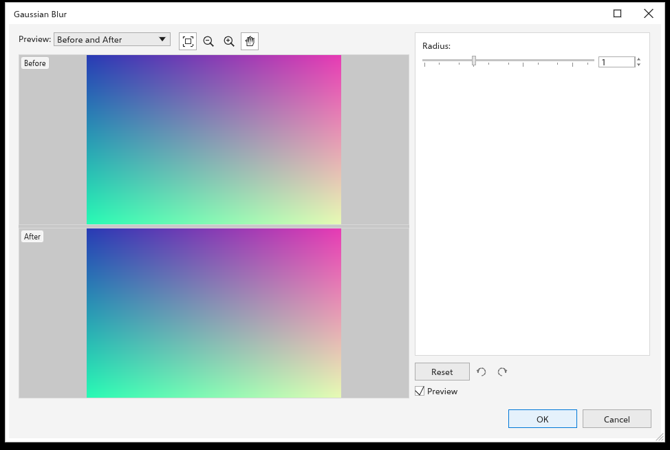

# Efeitos de bitmap

> *Tradução automática: esta página pode estar atrasada em relação à versão em inglês.*

Os efeitos de bitmap mudam pixels: desfocam, aumentam a nitidez, ajustam cores,
acrescentam texturas e traços artísticos. Funcionam em bitmaps e também em
objetos vetoriais, que passam a ser desenhados como a imagem que os efeitos
produzem, mantendo a própria forma, preenchimento e contorno.

Os efeitos ficam separados dos pixels originais: você pode editar, ocultar,
reordenar ou remover qualquer um depois, e remover o último devolve o original.

## Para aplicar um efeito de bitmap {#apply}

1. Selecione um ou mais objetos.
2. Escolha um grupo no menu [[menu.effects]] e um efeito.
3. Efeitos sem configurações são aplicados na hora. Os outros abrem uma caixa
   de diálogo redimensionável, com o primeiro objeto selecionado antes e
   depois na [Prévia de antes e depois](../bitmaps/before-after-preview.md) e
   as configurações à direita. O efeito também aparece no desenho e acompanha
   cada valor que muda (desmarque **Prévia** para desligar isso); o trabalho é
   feito em segundo plano, então a janela continua respondendo com imagens
   grandes. Clique em [[dialog.ok]] para guardar o que o desenho mostra em um
   passo de desfazer; **Cancelar** ou <kbd>Esc</kbd> devolvem o desenho
   exatamente como estava. **Redefinir** devolve todas as configurações ao
   padrão.

A alteração em toda a seleção é um passo de desfazer. Com um bitmap
selecionado, <kbd>Ctrl+B</kbd> abre [[fx.brightness_contrast_intensity]],
<kbd>Ctrl+Shift+B</kbd> [[fx.color_balance]] e <kbd>Ctrl+Shift+U</kbd>
[[fx.hue_saturation_lightness]].

## Os grupos de efeitos {#groups}

| Grupo | Efeitos |
|---|---|
| [[menu.effects.3d]] | [[fx.cylinder]], [[fx.emboss]], [[fx.page_curl]], [[fx.pinch_punch]], [[fx.sphere]] |
| [[menu.effects.adjust]] | [[fx.auto_adjust]], [[fx.image_adjustments]], [[fx.contrast_enhancement]], [[fx.local_equalization]], [[fx.target_balance]], [[fx.tone_curve]], [[fx.brightness_contrast_intensity]], [[fx.color_balance]], [[fx.gamma]], [[fx.hue_saturation_lightness]], [[fx.selective_color]], [[fx.replace_colors]], [[fx.desaturate]], [[fx.channel_mixer]] |
| [[menu.effects.art_strokes]] | [[fx.charcoal]], [[fx.conte_crayon]], [[fx.crayon]], [[fx.cubist]], [[fx.impressionist]], [[fx.palette_knife]], [[fx.pastels]], [[fx.pen_ink]], [[fx.pointillist]], [[fx.scraperboard]], [[fx.sketch_pad]], [[fx.watercolor]], [[fx.felt_marker]], [[fx.paper_grain]] |
| [[menu.effects.blur]] | [[fx.directional_smooth]], [[fx.gaussian_blur]], [[fx.jagged_edges]], [[fx.low_pass]], [[fx.motion_blur]], [[fx.radial_blur]], [[fx.smart_blur]], [[fx.smooth]], [[fx.soften]], [[fx.zoom]] |
| [[menu.effects.camera]] | [[fx.colorize]], [[fx.diffuse]], [[fx.photo_filter]], [[fx.sepia_toning]], [[fx.vintage_photo]] |
| [[menu.effects.color_transform]] | [[fx.bit_planes]], [[fx.halftone]], [[fx.psychedelic]], [[fx.solarize]] |
| [[menu.effects.contour_group]] | [[fx.edge_detect]], [[fx.find_edges]], [[fx.trace_contour]] |
| [[menu.effects.correction]] | [[fx.dust_and_scratch]] |
| [[menu.effects.creative]] | [[fx.crystallize]], [[fx.fabric]], [[fx.frame]], [[fx.glass_tiles]], [[fx.mosaic]], [[fx.scatter]], [[fx.tinted_glass]], [[fx.stained_glass]], [[fx.vignette]], [[fx.vortex]] |
| [[menu.effects.custom]] | [[fx.bump_map]] |
| [[menu.effects.distort]] | [[fx.blocks]], [[fx.displace]], [[fx.mesh_warp]], [[fx.offset]], [[fx.pixelate]], [[fx.ripple]], [[fx.swirl]], [[fx.tile]], [[fx.wet_paint]], [[fx.whirlpool]], [[fx.wind]] |
| [[menu.effects.noise]] | [[fx.add_noise]], [[fx.maximum]], [[fx.median]], [[fx.minimum]], [[fx.remove_moire]], [[fx.remove_noise]] |
| [[menu.effects.sharpen]] | [[fx.adaptive_unsharp]], [[fx.directional_sharpen]], [[fx.high_pass]], [[fx.sharpen]], [[fx.unsharp_mask]] |
| [[menu.effects.texture]] | [[fx.cobblestone]], [[fx.wrinkles]], [[fx.etching]], [[fx.plastic]], [[fx.relief_sculpture]], [[fx.stone]] |
| [[menu.effects.transform]] | [[fx.deinterlace]], [[fx.invert_colors]], [[fx.posterize]] |

## Caixas de diálogo especiais {#special-dialogs}

- **[[fx.image_adjustments]]** abre uma caixa de diálogo maior: uma prévia
  grande que você pode ampliar, deslocar e girar, mostrada sozinha, lado a
  lado ou dividida; **Ajuste automático** e seletores para os pontos de branco
  e de preto; controles de temperatura, matiz, saturação, brilho, contraste,
  realces, sombras e tons médios, com um histograma; desfazer e refazer dentro
  da caixa de diálogo; e instantâneos de configurações para comparar.
- **[[fx.contrast_enhancement]]** mostra o histograma com marcadores para
  arrastar os níveis de entrada e saída, conta-gotas para preto e branco e
  **Ajuste automático**.
- **[[fx.tone_curve]]** edita uma curva por canal (geral, vermelho, verde,
  azul) em quatro estilos (curva, reta, mão livre, gama), sobre o histograma;
  as curvas podem ser salvas e carregadas.
- As cores da imagem, como em [[fx.replace_colors]], têm um conta-gotas:
  clique em uma prévia para pegar a cor sob o ponteiro.

## Editar os efeitos de um objeto {#fx-section}

A seção [[docker.fx]] do painel [[docker.properties]] lista os efeitos do
objeto selecionado, o primeiro aplicado no topo. Cada linha tem uma caixa de
seleção para mostrar ou ocultar o efeito, **Editar** (abre a caixa de diálogo
dele), **Mover para cima**, **Mover para baixo** e **Excluir**. **Adicionar
efeito** abre os grupos de efeitos.

[[menu.effects > menu.effects.flatten]] torna os efeitos permanentes: um bitmap
fica com o que mostra, e um objeto vetorial vira bitmap.

## O seletor de efeitos {#effect-picker}

[[menu.effects > menu.effects.picker]] abre uma janela que fica aberta enquanto
você trabalha, com cada efeito como uma pequena imagem. Digite no campo de
busca para encontrar efeitos, ou escolha um grupo ou **Recentes** na lista. Com
algo selecionado, clique em um ladrilho para aplicar o efeito. Você também pode
aplicar um efeito como [lente](lens.md).

## Efeitos que passam das bordas {#inflate}

Desfoques e efeitos parecidos podem passar das bordas de um bitmap. Com
[[menu.bitmaps > menu.bitmaps.inflate > menu.bitmaps.inflate_auto]] ligado (como
de início), o bitmap cresce para dar espaço a eles. Veja
[Reamostrar e endireitar](../bitmaps/resample-and-straighten.md#inflate).

Para salvar um bitmap com os efeitos como arquivo PNG, clique nele com o botão
direito e escolha [[menu.bitmaps.save_bitmap_as]].
