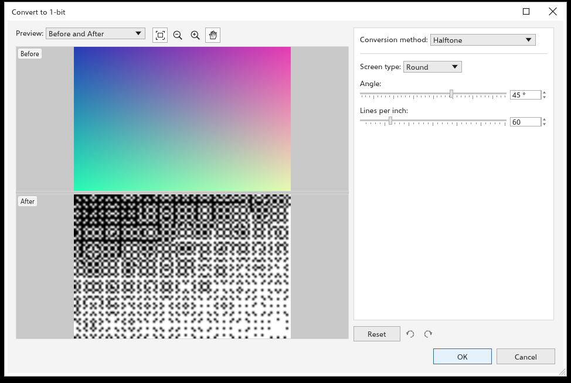
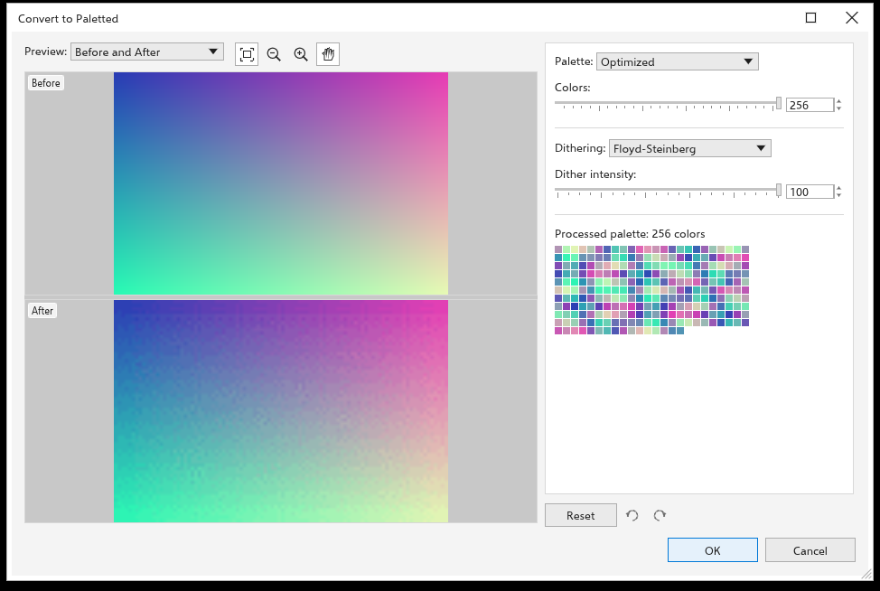

# Bitmaplerin renk modunu değiştirme

[[menu.bitmaps > menu.bitmaps.mode]] seçili bitmapleri başka bir renk moduna
dönüştürür. Seçili her bitmap tek bir geri alma adımında değişir ve saydamlık
korunur. Ayarları olan modlar, önce ve sonra önizlemeleri içeren bir iletişim
kutusu açar.

| Mod | Sonuç |
|---|---|
| [[menu.bitmaps.mode_bw]] | yalnızca siyah ve beyaz (aşağıya bakın) |
| [[menu.bitmaps.mode_grayscale]] | gri tonları |
| [[menu.bitmaps.mode_duotone]] | bir ile dört arası mürekkep (aşağıya bakın) |
| [[menu.bitmaps.mode_paletted]] | en çok 256 renk (aşağıya bakın) |
| [[menu.bitmaps.mode_rgb]] | pikseller olduğu gibi |
| [[menu.bitmaps.mode_lab]] | Lab rengi |
| [[menu.bitmaps.mode_cmyk]] | pikseller olduğu gibi; renk yönetimi çıktıda dönüştürür |

## Siyah ve beyaz {#black-and-white}

Dönüştürme yöntemini seçin:

- **Çizgi sanatı**: grinin **eşik** değerinde veya üstünde olduğu yerler
  beyaz (başlangıçta 128), diğer yerler siyah;
- **Sıralı**: düzenli bir nokta deseni;
- **Yarım ton** (başlangıçta): bir **açıda** (45 derece) ve belirli sayıda
  **inç başına çizgide** (60) yuvarlak, çizgi veya kare noktalardan oluşan bir
  tram;
- **Kardinalite Dağılımı**: rastgele görünen bir doku;
- **Jarvis**, **Stucki** ve **Floyd-Steinberg**: hata dağıtımı, fotoğraflar
  için en düzgün sonuçlar.

**Yoğunluk** (0 ile 100 arası, başlangıçta 50) sonucu daha açık veya daha koyu
yapar.

## Çift ton {#duotone}

Çift ton, gri tonlamalı bir resmi birkaç mürekkeple basar; bu da az renkle
zengin tonlar verir.

1. Türü seçin: bir ile dört mürekkep için Tek ton, Çift ton (başlangıçta), Üç
   ton veya Dört ton.
2. Rengini değiştirmek için bir mürekkebe tıklayın.
3. Eğrisini düzenleyin: yatay eksen gri düzeyidir (solda siyah), dikey eksen
   o mürekkepten ne kadar basılacağıdır. Nokta eklemek için boş alanda
   sürükleyin, taşımak için bir noktayı sürükleyin, kaldırmak için üzerine
   çift tıklayın veya ızgaranın dışına sürükleyin. **Tümünü göster** diğer
   mürekkeplerin eğrilerini de çizer.
4. **Kaydet** ve **Yükle** mürekkepleri ve eğrileri bir dosyada saklar.

## Paletli {#paletted}

- **Palet**: Tekdüze Renkler, Standart VGA (16 renk), Uyarlanabilir ve
  Optimize edilmiş (resmin kendi renkleri, ayarladığınız **renk** sayısına,
  en çok 256'ya indirilmiş), Gri tonlama, Sistem veya Özel (belge paleti).
- **Titreme**: Yok, Sıralı, Jarvis, Stucki veya Floyd-Steinberg, titreme
  yoğunluğuyla birlikte.

Ortaya çıkan palet ayarların altında görünür.

## Siyah beyaz bitmapleri renklendirme {#monochrome}

Yalnızca iki renkli bitmapler seçiliyken, arka planlarını renklendirmek için
bir palet rengine tıklayın, ön planlarını renklendirmek için sağ tıklayın.
