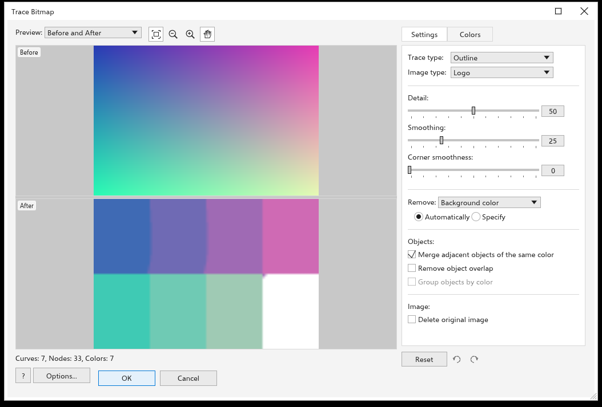

# 描繪點陣圖

描繪會將點陣圖轉換為向量形狀，讓您可以編輯、重新上色和縮放而不損失品質：掃描的標誌、草圖、相片都適用。

## 快速描繪 {#quick-trace}

選取點陣圖並選擇 [[menu.bitmaps > menu.bitmaps.quick_trace]]。它會使用全域選項的 [[options.bitmap_tracing]] 頁面上所選擇的預設集（預設為美工圖案）。

[[menu.bitmaps.repeat_last_trace]] 不開啟對話方塊，依上次的方式再次描圖所選點陣圖；[[menu.bitmaps.last_trace_settings]] 以上次的設定開啟對話方塊。點陣圖的右鍵選單中也有這些命令，以及 [[menu.bitmaps.centerline_trace]] 和 [[menu.bitmaps.outline_trace]]。

## 描繪點陣圖對話方塊 {#trace}

[[menu.bitmaps > menu.bitmaps.outline_trace]] 和 [[menu.bitmaps.centerline_trace]] 會列出預設集；選擇其中一個即可開啟描繪對話方塊。

- **外框描繪**以形狀填滿色彩區域：[[menu.bitmaps.trace_line_art]]、[[menu.bitmaps.trace_logo]]、[[menu.bitmaps.trace_detailed_logo]]、[[menu.bitmaps.trace_clipart]]、[[menu.bitmaps.trace_low_quality]] 和 [[menu.bitmaps.trace_high_quality]]。
- **中心線描繪**以開放曲線沿著線條描繪：[[menu.bitmaps.trace_technical]] 和 [[menu.bitmaps.trace_line_drawing]]。

對話方塊是一個可以調整大小和最大化的視窗。預覽佔據左側，設定位於右側的面板中，每當您變更設定時都會重新描繪：不必按任何按鈕就能看到結果。預覽下方的一行會計算描繪結果的**曲線**、**節點**和**色彩**數量。按一下 [[dialog.ok]] 將形狀放置在點陣圖上方（最暗的在最前面），或按一下 [[dialog.cancel]] 保持點陣圖不變。

## 預覽 {#preview}

[[dialog.trace_preview_label]] 清單選擇預覽顯示的內容：

- [[dialog.trace_view_before_after]]：點陣圖在上，描繪結果在下；或 [[dialog.view_side_by_side]]；[[dialog.before]] 只顯示點陣圖。
- [[dialog.trace_view_large]]：只顯示描繪結果，和預覽一樣大。
- [[dialog.trace_view_wireframe]]：描繪結果的曲線以細線畫在點陣圖上。清單旁邊會出現 [[dialog.trace_overlay]] 滑桿：它設定點陣圖在線條下顯示的強度，從 0（只有線條）到 100（點陣圖原樣），預設為 80。

清單後面的按鈕分別是縮放至適合、縮小、放大和平移。滾輪以指標為中心縮放，拖曳則移動圖片；兩個窗格一起移動。透明部分顯示棋盤格。

## 設定 {#settings}

[[dialog.trace_tab_settings]] 索引標籤包含：

- [[dialog.trace_type]] 外框或中心線，以及 [[dialog.trace_image_type]] 預設集。選擇一個預設集會把下方的滑桿設為適合該類圖片的值。
- [[dialog.detail]]（0 到 100）：細節越多，保留的小區域和細線越多；細節越少，斑點和顆粒越平滑。
- [[dialog.smoothing]]（0 到 100，預設為 25）：曲線更平滑、節點更少。
- [[dialog.corner_smoothness]]（0 到 100）：轉角更圓。
- [[dialog.trace_remove]]：從描繪結果中省略什麼。**背景色彩**移除到達圖片邊緣的背景，**影像中的整個色彩**移除該色彩的每個區域，**無**描繪所有內容。[[dialog.trace_remove_auto]] 沿圖片邊緣尋找背景色彩；[[dialog.trace_remove_specify]] 使用色票的色彩，您可以變更它，或用旁邊的滴管從預覽中取色。
- [[dialog.trace_objects]]：[[dialog.trace_merge_adjacent]]（預設開啟）把一種色彩的所有區域合成一條曲線；關閉時，每個獨立的色塊是一條單獨的曲線。[[dialog.trace_remove_overlap]] 讓每個形狀只佔自己的像素；關閉時，形狀會稍微伸到上方形狀的下面，相鄰形狀之間就不會出現縫隙。[[dialog.trace_group_by_color]] 把每種色彩的曲線放進各自的群組；當一種色彩的區域尚未合併時可用。
- [[dialog.delete_original]]：放置描繪結果時刪除點陣圖。

不適用於目前描繪類型的設定會顯示為灰色：中心線描繪只讀取細節和平滑度。

## 色彩 {#colors}

[[dialog.trace_tab_colors]] 索引標籤設定 [[dialog.color_mode]]（RGB、灰階或黑白）和 [[dialog.trace_number_of_colors]]（2 到 256），並列出描繪結果的色彩及每種色彩的曲線數量。勾選兩種或更多色彩並按一下 [[dialog.trace_merge_colors]]，可將它們合併到第一種色彩；按一下某種色彩的色票，可用另一種色彩繪製它的曲線。變更會重新描繪圖片的設定時，這些屬於上一次描繪的編輯會被忘記。

## 重設、復原和重做 {#steps}

在設定面板下方，[[dialog.reset]] 恢復預設集的設定，兩個箭頭在對話方塊中所做的每項變更之間前後移動：每次放開滑桿、選擇清單項目、勾選核取方塊、編輯色彩和重設都是一步。復原後所做的變更會捨棄已復原的步驟。

[[dialog.trace_options]] 開啟全域選項的 [[options.bitmap_tracing]] 頁面，您可以在那裡選擇快速描繪的預設集以及每次描繪的起始選項，然後返回對話方塊。[[dialog.help_button]] 按鈕會開啟此頁面。
